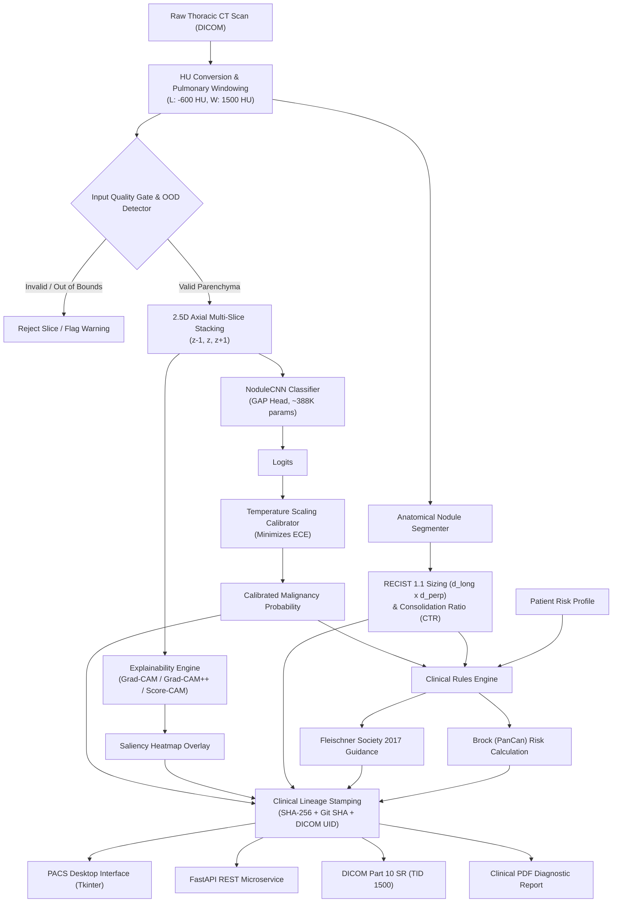

# Pulmonary Nodule Diagnostic Intelligence (CADx) & Decision Support System

[](https://www.python.org/downloads/)
[](https://pytorch.org/)
[](https://fastapi.tiangolo.com)
[](https://onnxruntime.ai/)
[](https://www.docker.com/)
[](LICENSE)

An end-to-end, clinically calibrated Computer-Aided Detection & Diagnosis (CADe/CADx) platform for thoracic Computed Tomography (CT) scans. Combines deep learning with evidence-based clinical guidelines (**Fleischner Society 2017** and **Brock University / PanCan Model**) and medical imaging standards (**DICOM Part 10 Structured Reporting**).

---

## 📋 Table of Contents
- [Key Features](#-key-features)
- [System Architecture](#-system-architecture)
- [Clinical & Scientific Foundation](#-clinical--scientific-foundation)
- [Project Directory Structure](#-project-directory-structure)
- [Installation & Setup](#-installation--setup)
- [Usage & Running](#-usage--running)
  - [1. PACS Desktop Application](#1-pacs-desktop-application)
  - [2. FastAPI REST Microservice](#2-fastapi-rest-microservice)
  - [3. Docker Container](#3-docker-container)
  - [4. End-to-End Pipeline Verification](#4-end-to-end-pipeline-verification)
- [Testing & Quality Assurance](#-testing--quality-assurance)
- [Regulatory & Clinical Disclaimer](#-regulatory--clinical-disclaimer)

A research-prototype Computer-Aided Diagnosis (CADx) and decision-support
system for thoracic CT scans. It combines a lightweight CNN with the
Fleischner Society 2017 guidelines and the Brock (PanCan) risk model, and
exports DICOM Structured Reports and PDF reports.

## Key Features

- **DICOM ingestion:** Reads 16-bit DICOM with pydicom, converts to
  Hounsfield Units using rescale slope and intercept, and applies a lung
  window (center -600 HU, width 1500 HU).
- **Quality gate:** Rejects non-CT modalities and empty air slices
  (below -900 HU) before inference.
- **2.5D input:** Stacks three adjacent axial slices (z-1, z, z+1).
- **Compact CNN:** `NoduleCNN` has 388,577 parameters (1-channel) and
  389,153 (3-channel). Global Average Pooling replaces a 33.5M-parameter
  dense layer and makes it resolution-agnostic.
- **ONNX export:** FP32 and INT8 models. Measured on CPU over 50
  iterations: FP32 25.22 ms per slice, INT8 31.36 ms per slice. INT8 is
  not smaller or faster, because only MatMul/Gemm layers are quantized
  and most weights are in Conv2d layers.
- **Temperature scaling:** Implemented as a PyTorch module. The stored
  temperature in `model/calibrator.pth` is 0.913. No before/after ECE
  benchmark is included.
- **Explainability:** Grad-CAM, Grad-CAM++, Score-CAM and Integrated
  Gradients, with context-managed hooks. Hook cleanup is covered by tests.
- **Morphometry:** RECIST 1.1 longest and perpendicular diameters and
  Consolidation-to-Tumor Ratio, measured on a single axial slice by
  region growing. Spiculation is a 2D contour heuristic.
- **Clinical rules:** Fleischner 2017 decision rules and the Brock
  (PanCan) logistic model (age, sex, family history, emphysema, size,
  lobe, spiculation).
- **Reporting:** DICOM Basic Text Structured Reports and multi-page PDF
  reports (ReportLab), each stamped with the model SHA-256, Git commit
  SHA and SeriesInstanceUID.
- **Interfaces:** Tkinter desktop viewer and a FastAPI service
  (`/health`, `/predict`, `/explain`) with Docker and Docker Compose.
  
## 🏗️ System Architecture



---

## 🔬 Clinical & Scientific Foundation

1. **Fleischner Society 2017 Guidelines:** *Bankier AA, et al. Recommendations for Measuring Pulmonary Nodules at CT: A Statement from the Fleischner Society. Radiology 2017; 288(3):899-906.*
2. **Brock University / PanCan Risk Model:** *McWilliams A, et al. Probability of Cancer in Pulmonary Nodules Detected on First Screening CT. N Engl J Med 2013; 369:910-919.*
3. **RECIST 1.1 Criteria:** *Eisenhauer EA, et al. New response evaluation criteria in solid tumours: Revised RECIST guideline (version 1.1). Eur J Cancer 2009; 45(2):228-247.*
4. **LIDC-IDRI Cohort:** *Armato SG 3rd, et al. The Lung Image Database Consortium (LIDC) and Image Database Resource Initiative (IDRI). Med Phys 2011; 38(2):915-931.*

---

## 📂 Project Directory Structure

```text
├── assets/                     # Application icons and GUI resources
├── data/                       # LIDC dataset ingestion and crop loaders
├── dist/                       # Output artifacts, ONNX models, and reports
│   └── onnx/                   # Exported FP32 and INT8 ONNX models
├── expert_system/              # Clinical guideline rules & risk calculators
│   ├── brock_model.py          # Brock University (PanCan) logistic model
│   └── rules.py                # Fleischner Society 2017 decision tree
├── explainability/             # Explainable AI & Uncertainty Calibration
│   ├── calibration_and_saliency.py # Temperature scaling, ECE, Score-CAM
│   └── gradcam.py              # Context-managed Grad-CAM & Grad-CAM++
├── model/                      # PyTorch neural network definitions & weights
│   ├── model.py                # NoduleCNN architecture & inference pipeline
│   ├── best_model.pth          # Calibrated checkpoint
│   └── calibrator.pth          # Learned temperature parameter
├── preprocessing/              # Medical image transformation & segmentation
│   ├── nodule_segmenter.py     # RECIST 1.1 morphometry & CTR calculation
│   └── volume_ood.py           # 2.5D context stacker & HU OOD quality gate
├── reports/                    # Clinical documentation and PACS outputs
│   ├── dicom_sr.py             # DICOM Part 10 Structured Reporting (SR)
│   ├── lineage.py              # Provenance & audit hashing
│   └── pdf_adapter.py          # Multipage ReportLab clinical PDF generator
├── scripts/                    # Verification, ONNX export, and training
│   ├── export_onnx.py          # PyTorch to ONNX quantization exporter
│   ├── train_lidc.py           # Patient-disjoint training pipeline
│   └── verify_e2e.py           # End-to-end integration smoke test
├── service/                    # Production REST Microservice
│   └── app.py                  # FastAPI server with /health, /predict, /explain
├── tests/                      # Automated unit and integration test suite
├── utils/                      # DICOM I/O, windowing, and metric utilities
├── Dockerfile                  # Production container definition
├── docker-compose.yml          # Container orchestration configuration
├── gui.py                      # Multi-threaded desktop PACS viewer
├── requirements.txt            # Python dependencies
└── start.bat                   # Interactive Windows launcher
```

---

## ⚙️ Installation & Setup

### Prerequisites
* Python 3.10 or higher
* Recommended: Virtual Environment (`venv` or `conda`)

```bash
# Clone the repository
git clone https://github.com/Ahmed151-badawy/Lung_Nodule_scanner.git
cd Lung_Nodule_scanner

# Create and activate a virtual environment
python -m venv .venv
# On Windows:
.venv\Scripts\activate
# On Linux/macOS:
source .venv/bin/activate

# Install dependencies
pip install --upgrade pip
pip install -r requirements.txt
```

---

## 🖥️ Usage & Running

### 1. PACS Desktop Application
Launch the PACS desktop interface for interactive nodule inspection, zoom/pan navigation, seed-point segmentation, and one-click PDF/DICOM SR generation:

```bash
python gui.py
```
*(Or double-click `start.bat` on Windows and select Option `1`)*

### 2. FastAPI REST Microservice
Run the high-performance async microservice:

```bash
uvicorn service.app:app --host 0.0.0.0 --port 8000 --reload
```
Interactive OpenAPI documentation will be accessible at:
* Swagger UI: `http://localhost:8000/docs`
* ReDoc: `http://localhost:8000/redoc`

#### Example Endpoint Usage:
* `GET /health` - Checks model readiness, device, and service status.
* `POST /predict` - Uploads a CT slice (DICOM or image), returns calibrated probability, RECIST measurements, and Brock risk tier.
* `POST /explain` - Returns base64-encoded Grad-CAM saliency heatmaps with localization coordinates.

### 3. Docker Container
Build and start the containerized service:

```bash
# Build and run with Docker Compose
docker-compose up --build -d

# Check health probe
curl -f http://localhost:8000/health
```

### 4. End-to-End Pipeline Verification
Execute the full verification harness (synthesizes calibrated CT slice, tests quality gate, generates Grad-CAM, computes RECIST 1.1 & Brock risk, and produces PDF/DICOM SR reports in `dist/`):

```bash
python scripts/verify_e2e.py
```

---

## 🧪 Testing & Quality Assurance

The codebase includes an automated test suite comprising 56 unit and integration tests covering:
* Model parameter limits (<1M params) and spatial-resolution invariance.
* Memory-leak-free context lifecycle of Grad-CAM hooks.
* Temperature scaling numerical correctness and ECE calculations.
* DICOM slope/intercept conversion and HU window boundary clipping.
* Out-of-distribution quality gating (empty air scans & non-CT modality rejection).
* RECIST 1.1 dual-axis accuracy and Consolidation-to-Tumor Ratio (CTR).
* Brock University (PanCan) risk calculator boundaries.
* DICOM Part 10 SR tag generation and ReportLab PDF creation.

Run all tests via `unittest`:

```bash
python -m unittest discover tests
```

---


  
## ⚖️ Regulatory & Clinical Disclaimer

> [!CAUTION]
> **RESEARCH & INVESTIGATIONAL PROTOTYPE ONLY**  
> This software system is developed strictly for research, benchmarking, and educational purposes. It is **NOT** a certified Medical Device (SaMD) and has not received clearance or approval from the U.S. Food and Drug Administration (FDA), CE marking under the European Medical Device Regulation (EU MDR), or equivalent health authorities. It must **NOT** be used as a primary diagnostic tool or to guide direct patient management without qualified radiologist over-read. All clinical decisions remain the sole legal responsibility of the licensed treating medical team.

